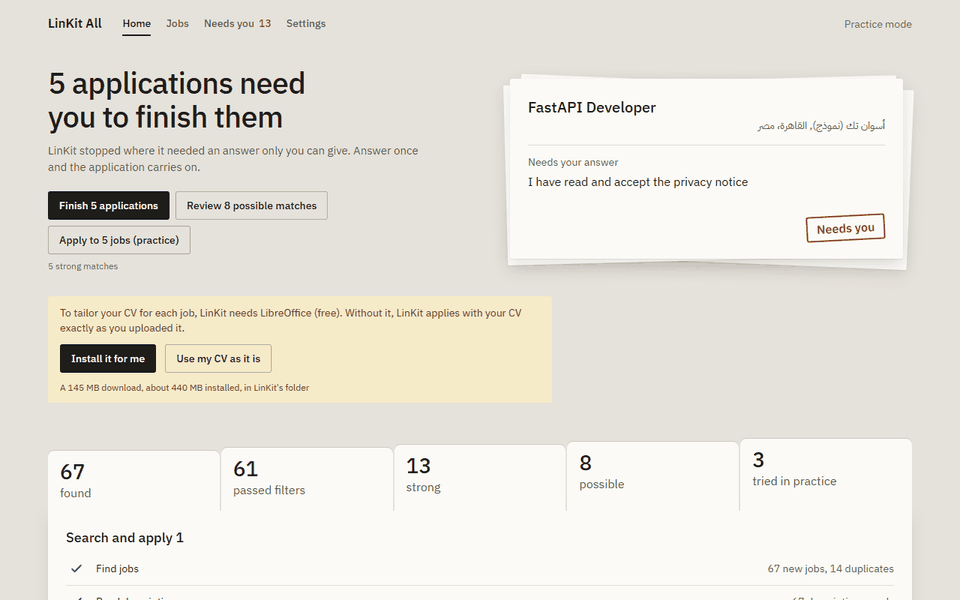
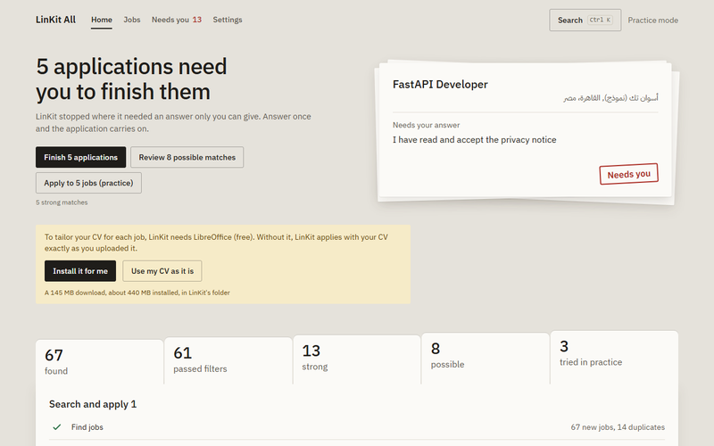
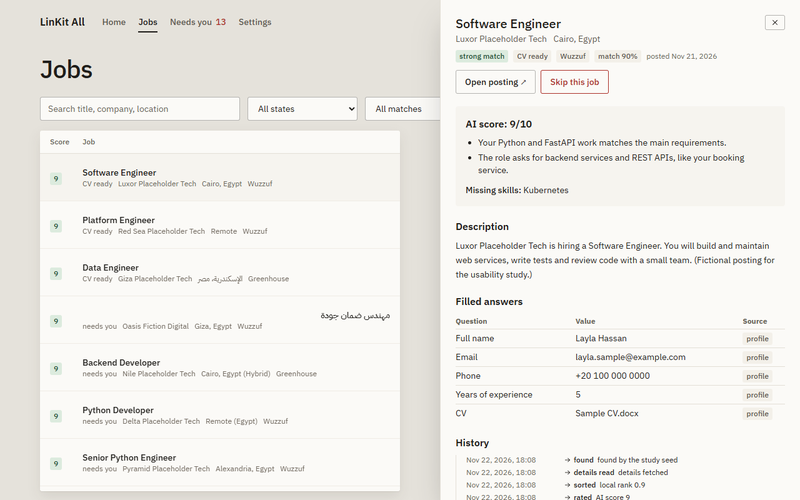
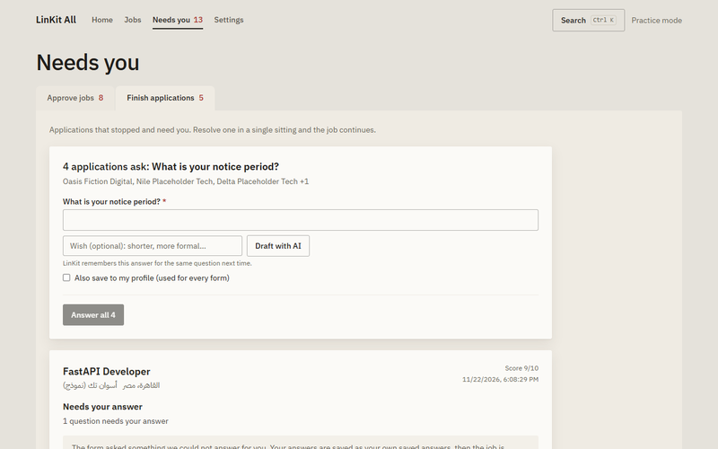

<p align="center">
  
</p>

<h1 align="center">LinKit All</h1>

<p align="center"><b>Your job hunt on autopilot, on your own computer.</b><br>
Open-source AI job search and auto-apply: it finds jobs, ranks them against your CV, tailors your CV in small checked edits, and fills in the applications.</p>

<p align="center">
  <a href="https://pypi.org/project/linkit-all/"></a>
  <a href="https://pypi.org/project/linkit-all/"></a>
  <a href="https://github.com/silentco2/LinKit-All/blob/main/LICENSE"></a>
  <a href="https://github.com/silentco2/LinKit-All/actions/workflows/ci.yml"></a>
  <a href="https://github.com/silentco2/LinKit-All/stargazers"></a>
  <a href="https://pypi.org/project/linkit-all/"></a>
</p>

<p align="center">
  <a href="https://linkit-all.github.io/docs/install/"><b>Install</b></a> ·
  <a href="https://linkit-all.github.io/docs/"><b>Docs</b></a> ·
  <a href="https://linkit-all.github.io/docs/compare/"><b>Compare</b></a> ·
  <a href="https://github.com/silentco2/LinKit-All/discussions"><b>Discussions</b></a>
</p>



<sub>Made-up study data (`scripts/record_demo.py`); nothing was submitted.</sub>

**⭐ If it saves you an application, star the repo. That's how other job seekers find it.**

## Why LinKit All

- **Local and private.** It runs on your computer. Your CV and job text go only to the AI you pick, and with a local model they never leave your machine. No account, no telemetry.
- **Your CV is never rewritten.** Tailoring changes a few words per job and keeps your layout. Rules refuse edits that change employers, titles, dates, degrees or numbers.
- **Sensitive questions never go to the AI.** Visa, salary, demographics and similar questions are answered from your saved profile, or they wait for you.
- **Bring any AI.** A ChatGPT plan (Codex CLI), a Claude plan (Claude Code CLI), an API key, or a local model through Ollama or LM Studio.
- **Safe by default.** Practice mode fills every form but never presses Submit. You switch to Applying for real when you trust it.

It is an auto-apply tool, not a job application bot that sprays CVs: it applies on Greenhouse, Lever and Ashby with dedicated handlers, and on Workday and other sites through a general AI form agent. Looking for a LinkedIn Easy Apply alternative that won't get your account banned? LinKit All never drives LinkedIn, Indeed or Glassdoor. A browser extension fills those forms while you press Submit. It works on Windows, macOS and Linux.

> **بالعربية:** الواجهة كاملة بالعربية، والترتيب وكشف الإعلانات المزيفة يعملان على الوظائف العربية. [الوثائق](https://linkit-all.github.io/docs/)

## Quick start

You need [uv](https://docs.astral.sh/uv/). Then:

```bash
uv tool install linkit-all
linkit doctor     # checks LibreOffice, the browser and your AI tools
linkit            # opens http://127.0.0.1:8765
```

The first run opens a setup page: upload your CV, pick an AI, check what was found, say what jobs you want. Step by step for each system: [Install](https://linkit-all.github.io/docs/install/), then [Setup](https://linkit-all.github.io/docs/setup/).

- **LibreOffice** is needed to tailor Word, OpenDocument and PDF CVs (LaTeX CVs need Tectonic instead). Without it, applications go out with your CV as uploaded. On Windows the app installs it for you in one click.
- **Applying** needs Chrome, Edge, Brave or Chromium. Finding and ranking jobs do not.

<details>
<summary>From source (needs Node.js 24 for the web page)</summary>

```bash
git clone https://github.com/silentco2/LinKit-All.git
cd LinKit-All
uv sync
cd frontend && npm ci && npx ng build && cd ..
uv run linkit
```

</details>

## What it does

1. **Finds jobs** on 295 sources: public job APIs of Greenhouse, Lever, Ashby, Workday and 100+ other applicant tracking systems, LinkedIn, Indeed and Glassdoor listings, regional boards, any careers page you list.
2. **Ranks them** against your CV and preferences. Ranking runs locally and costs no AI calls. An offline check flags scam and ghost jobs.
3. **Tailors your CV** for each job (AI resume tailoring with word-level edits). Layout and style are left alone.
4. **Applies for you**, including on sites that need an account first. Questions it should not guess wait for you.
5. **Shows it all** in a local web page: a live view of the run, jobs to review, a "Needs you" list, and a results report.

| Home | Jobs | Needs you |
|---|---|---|
|  |  |  |

## How it compares

| | LinKit All | AIHawk | ApplyPilot |
|---|---|---|---|
| AI it works with | ChatGPT or Claude plan, API keys, local models (Ollama, LM Studio) | A key from OrcaRouter; others not stated | Gemini key (OpenAI and local also supported); auto-apply needs Claude Code |
| CV per job | Small word-level edits to your own file, facts locked | Not stated | Rewritten by AI per job |
| Sensitive questions | Never sent to the AI | Not stated | Answered with AI |
| Telemetry | None | Not stated | Not stated |

From each project's own README, read on 2026-11-12. Sources, caveats and where LinKit All is weaker: [full comparison](https://linkit-all.github.io/docs/compare/).

## How well it works

- **Real postings:** of 115 real job postings run in Practice mode with a made-up profile, 67 of the 70 the app may finish on its own (96%) went as far as Practice mode allows. Small sample, nothing submitted: see the [scorecard](https://linkit-all.github.io/docs/scorecard/).
- **10,000 fake jobs:** 800 of 800 duplicates found, 92.9% of planted scams caught with 0 false alarms, 100% relevant jobs in the top 10, in 110 seconds.
- **CV guard:** 17 of 19 planted dishonest edits refused, all 6 honest ones accepted.
- These are tests the authors wrote, not real-world accuracy. Full tables and how to reproduce them: [Results and limits](https://linkit-all.github.io/docs/results/).

## Limits

- Only Greenhouse, Lever and Ashby have dedicated form handlers. Workday, iCIMS and the rest go through the general form agent, which filled 11 of 55 such postings to the end in the latest scorecard run.
- Real submitting has been tried only in a few applications watched by hand. Watch your first run.
- LinkedIn, Indeed and Glassdoor are never driven by the app; you apply there in your own browser with the LinKit Fill extension.
- CAPTCHAs are never solved. The job waits for you.

All limits: [Results and limits](https://linkit-all.github.io/docs/results/).

## Privacy

- Your CV, answers and settings live in one data folder on your computer. Saved passwords are in an encrypted vault there.
- Your CV and job text go only to the AI provider you choose. With a local model, they stay on your computer.
- No telemetry, analytics or crash reporting.

Everything the app connects to, and why: [Privacy and security](https://linkit-all.github.io/docs/privacy/).

## Roadmap

Wanted next: dedicated [Workday](https://github.com/silentco2/LinKit-All/issues/6) and [iCIMS](https://github.com/silentco2/LinKit-All/issues/7) handlers, and the [LibreOffice bundle for macOS and Linux](https://github.com/silentco2/LinKit-All/issues/8). See the [changelog](https://github.com/silentco2/LinKit-All/blob/main/CHANGELOG.md) for what shipped.

## Contributing

New job boards and site handlers are the most useful help: [add a job board from your country](https://github.com/silentco2/LinKit-All/issues/9). Read [CONTRIBUTING.md](https://github.com/silentco2/LinKit-All/blob/main/CONTRIBUTING.md) first. To report a security problem, read [SECURITY.md](https://github.com/silentco2/LinKit-All/blob/main/SECURITY.md). Questions go to [Discussions](https://github.com/silentco2/LinKit-All/discussions).

## Star history

[](https://star-history.com/#silentco2/LinKit-All&Date)

## License

AGPL-3.0-or-later. See [LICENSE](https://github.com/silentco2/LinKit-All/blob/main/LICENSE). Code reused from ApplyPilot and AIHawk is listed in [NOTICE](https://github.com/silentco2/LinKit-All/blob/main/NOTICE).
