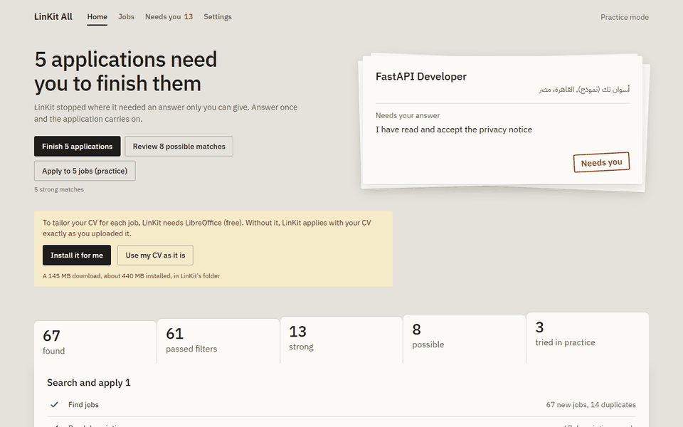

# LinKit All

**Open-source AI job search that runs on your computer: it finds jobs, ranks them against your CV, tailors your CV honestly and fills in the applications.**

[Docs](https://silentco2.github.io/LinKit-All/) · [Install](https://silentco2.github.io/LinKit-All/install/) · [Compared with AIHawk and ApplyPilot](https://silentco2.github.io/LinKit-All/compare/) · [Changelog](https://github.com/silentco2/LinKit-All/blob/main/CHANGELOG.md)

You bring your own AI: a ChatGPT plan (Codex CLI), a Claude plan (Claude Code CLI), an API key, or a local model such as Ollama or LM Studio. It works on Windows, macOS and Linux, in English and Arabic.

> It starts in Practice mode: it fills forms and takes screenshots but never presses Submit. Real submitting is new; watch your first run.



<sub>Made-up study data (`scripts/record_demo.py`); nothing was submitted.</sub>

## What it does

1. Finds jobs from the job boards and company career pages you list.
2. Ranks them against your CV and preferences. Ranking runs locally and costs no AI calls.
3. Tailors your CV for each job with small word-level edits. Layout and style are left alone, and it may not invent employers, titles, dates, degrees or numbers.
4. Applies for you, including on sites that need an account first. Questions it should not guess (visa, salary, demographics and similar) are never answered by the AI: they are answered from your profile when you saved the answer there, and otherwise they wait for you.
5. Shows all of it in a local web UI: setup, a live view of the run, jobs to review, a "Needs you" list, and a results report.

## Quick start

You need [uv](https://docs.astral.sh/uv/). Then:

```bash
uv tool install linkit-all
linkit doctor     # checks LibreOffice, the browser and your AI tools
linkit            # opens http://127.0.0.1:8765
```

The first run opens a setup page: upload your CV, pick an AI, check what was found, say what jobs you want. Step-by-step for each system: [Install](https://silentco2.github.io/LinKit-All/install/). Then [Setup](https://silentco2.github.io/LinKit-All/setup/).

- **LibreOffice** is needed to tailor Word, OpenDocument and PDF CVs (LaTeX CVs need Tectonic instead). Without it, applications go out with your CV as uploaded. On Windows the app installs it for you in one click.
- **Applying** needs Chrome, Edge, Brave or Chromium. Finding and ranking jobs do not.

From source (needs Node.js 24 for the web page):

```bash
git clone https://github.com/silentco2/LinKit-All.git
cd LinKit-All
uv sync
cd frontend && npm ci && npx ng build && cd ..
uv run linkit
```

## How well does it work

A built-in fake job board generates made-up jobs whose right answers are known: which are duplicates, scams, ghost jobs, relevant, or invented CV edits. The people who wrote the code also wrote this test, so these numbers show that the pieces behave as designed. They are not real-world accuracy. To reproduce them, run `uv run linkit bench`. The form-filling rows need `uv run linkit bench --apply 9`, and the tailoring row with a real model needs `--provider claude_cli --model haiku` (or any provider and model you have). The tailoring figures below came from a run with `--jobs 100`. The figures are from a run on 2026-11-11 and can shift as the code and the fake jobs change.

10,000 fake jobs, a scripted stand-in for the AI, the real local embedding model:

| What was measured | Result |
|---|---|
| Duplicate jobs found (800 planted) | 800 found, 0 wrong |
| Scam jobs found (268 planted) | 249 found, 0 false alarms, 92.9% caught; the 19 missed were all titled "Office Administrator" |
| Ghost jobs found | 274 found, 0 wrong, 0 missed |
| Ranking: how many of the top 10 and top 50 were relevant | 100% and 100% |
| Fake application forms (9: simple, two-page, sensitive) | 9 of 9 ended as expected: 6 filled in Practice mode, 3 sensitive-question forms waited for the user. 18 of 18 fields right, CV attached 3 of 3, 3 of 3 trap fields left empty, nothing sensitive sent to the AI |
| Speed | 110 seconds for 10,000 jobs (find, enrich, rank) on one machine |

CV tailoring guard, run on 100 fake jobs with Claude Haiku as the claim checker. The test planted 25 edits that we wrote for it: 6 honest and 19 that must be refused. Of those 19, 15 invent or change a fact (a changed employer, date, metric or email, an inflated title, an unlisted tool, a bigger role) and 4 break a formatting rule (Arabic text, a line break, text that is not in the CV, a segment grown far past its length). All 19 were refused and all 6 honest edits accepted. This is one model on a small set of cases, not a guarantee that invented edits never get through.

Real sites: `uv run linkit apply-probe` tries real postings in Practice mode. The [scorecard](https://silentco2.github.io/LinKit-All/scorecard/) is a first, small sample: 18 postings, a made-up test profile, and nothing submitted. Of those, 1 form was filled to the end and 17 stopped for a reason (a question for the user, a sign-up wall, a site the app never drives, or a form the agent could not finish). It shows where applications stop. It is not a success rate.

## Limits

- Only Greenhouse, Lever and Ashby have dedicated form handlers. Every other site (Workday, iCIMS, Taleo and the rest) goes through a generic AI form agent. In the first scorecard run it filled none of its 12 postings (3 per source) to the end. On 5 of them it could not find or finish the form. Of the other 7, 3 stopped at a sign-up page (Practice mode never creates an account), 3 were LinkedIn postings the app never drives, and 1 had questions left for you.
- LinkedIn, Indeed and Glassdoor are never driven by the app. The job waits and you apply in your own browser, where the LinkIt Fill extension fills each step.
- Practice mode is the default. Real submitting (Applying for real) has so far been tried only in a few applications the maintainer watched by hand, and the automated tests run in Practice mode only. Watch your first run.
- CAPTCHAs are never solved. The job waits for you.
- The one-click LibreOffice install is Windows 64-bit only. On macOS and Linux, install LibreOffice yourself.
- macOS and Linux run the unit tests and the benchmark in CI on every change; the full install has been checked by hand on Windows only.
- AI use counts against your own plan limits or API key. When a limit is hit, the run pauses.
- Small local models may score and tailor less well.

## Privacy

- Your CV, answers and settings live in one data folder on your computer. Saved passwords are in an encrypted vault there; its key can be cached in your operating system's keyring.
- Your CV and job text are sent for AI processing only to the AI provider you choose. With a local model, that text stays on your computer. Your CV file itself goes to the sites and employers you apply to, as any application does.
- Other traffic, which happens even with a local model (this is not your CV or job text):
  - always: the job sites and career pages you list, and the sites you apply on (the app also reads each site's `robots.txt`, only for its `Crawl-delay`);
  - if you connect email: your mail server (Gmail or Yahoo IMAP and SMTP; Microsoft sign-in and Microsoft Graph for Outlook);
  - a one-time download of the ranking model, and an exchange-rate refresh that sends no personal data;
  - only if you turn it on: the one-click LibreOffice download from the project's GitHub release, Google search in the app browser for the LinkedIn hiring posts source, Google's sign-in pages if you turn on "Sign in with Google", Telegram channel previews (`t.me/s`) for channels you list, and Common Crawl's index when you run `linkit discover-boards`.
- LinKit All itself contacts nothing else. The browser it drives, the pages that browser loads, the AI command-line tool you pick, and Tectonic (which downloads TeX files the first time it compiles a LaTeX CV) make their own connections, which the app does not control.
- There is no telemetry, analytics or crash reporting.
- LinKit All never asks the AI to answer sensitive questions and never adds your saved answers to a prompt. The form agent does send a short piece of the page's own text to the AI, with your sensitive answers removed first. A value shown in a different form can still get through; see [docs/privacy.md](https://silentco2.github.io/LinKit-All/privacy/). Your passwords are never sent to the AI.

Details: [Privacy and security](https://silentco2.github.io/LinKit-All/privacy/).

## Docs

[Install](https://silentco2.github.io/LinKit-All/install/) · [Setup](https://silentco2.github.io/LinKit-All/setup/) · [Sources](https://silentco2.github.io/LinKit-All/sources/) · [Matching](https://silentco2.github.io/LinKit-All/matching/) · [Job trust check](https://silentco2.github.io/LinKit-All/trust/) · [Tailoring](https://silentco2.github.io/LinKit-All/tailoring/) · [Applying](https://silentco2.github.io/LinKit-All/applying/) · [Action Center](https://silentco2.github.io/LinKit-All/action-center/) · [Scheduling and reports](https://silentco2.github.io/LinKit-All/scheduling-reports/) · [LinkedIn posts](https://silentco2.github.io/LinKit-All/linkedin-posts/) · [CLI](https://silentco2.github.io/LinKit-All/cli/) · [Troubleshooting](https://silentco2.github.io/LinKit-All/troubleshooting/) · [Apply scorecard](https://silentco2.github.io/LinKit-All/scorecard/) · [Compared with AIHawk and ApplyPilot](https://silentco2.github.io/LinKit-All/compare/) · [Development](https://silentco2.github.io/LinKit-All/development/)

To contribute, read [CONTRIBUTING.md](https://github.com/silentco2/LinKit-All/blob/main/CONTRIBUTING.md). To report a security problem, read [SECURITY.md](https://github.com/silentco2/LinKit-All/blob/main/SECURITY.md).

## License

AGPL-3.0-or-later. See [LICENSE](https://github.com/silentco2/LinKit-All/blob/main/LICENSE). Code reused from ApplyPilot and AIHawk is listed in [NOTICE](https://github.com/silentco2/LinKit-All/blob/main/NOTICE).
